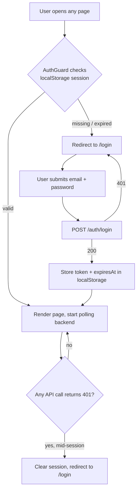
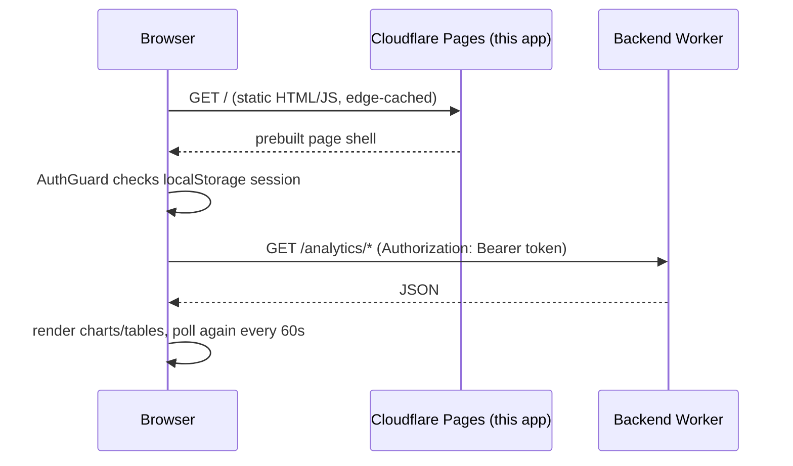

# Contract Monitor — Frontend

The operator dashboard for the BorrowLend contract monitor: traffic, gas, and revert analytics
for a live Polygon mainnet contract, behind a login screen. Talks to the
[backend Worker](https://github.com/Arish0/contract-monitor-backend) over a plain REST API —
this app has no server of its own and no backend logic; it's a static site.

## Stack

| Layer | Technology |
|---|---|
| Framework | [Next.js 16](https://nextjs.org/) (App Router), statically exported (`output: "export"`) |
| Hosting | [Cloudflare Pages](https://pages.cloudflare.com/) — static asset hosting, no server runtime |
| UI | React 19, Tailwind CSS v4 |
| Charts | [Recharts](https://recharts.org/) |
| Auth | Custom session-token auth against the backend — no cookies, no third-party provider |
| Language | TypeScript |

## Why a static export

Every page in this app is a client component (`"use client"`) that fetches its data from the
backend Worker after the page loads — there's no server-side rendering, no API routes, and
nothing here needs a Node.js runtime. A static export is the simplest, cheapest, and most secure
option: Cloudflare Pages just serves prebuilt HTML/CSS/JS from the edge, and the only thing that
can ever go wrong at "the server" is a CDN cache miss.

## Auth model

There's no server session and no cookies. Login exchanges an email/password for a signed,
48-hour session token, which the browser holds in `localStorage` and sends as
`Authorization: Bearer <token>` on every API call. The backend is the sole authority on whether
a token is valid — this app never trusts its own local state without the backend confirming it.



`AuthGuard` (wraps every page except `/login`) also re-checks the stored expiry every 30 seconds,
so a session that quietly expires while a tab is left open gets redirected to `/login` on its own
— you don't need to make a failing API call to discover you're logged out.

## Pages

| Route | Purpose | Auth |
|---|---|---|
| `/login` | Email/password sign-in, generic branding (doesn't name the product) | Public |
| `/` | Main dashboard — stats, charts, recent transactions, notification toggles | Protected |
| `/transactions` | Full transaction list for the selected date range, scrollable | Protected |
| `/change` | Change the operator email/password. **Deliberately not linked from any nav** — reachable only by navigating to it directly while logged in | Protected |

## Project structure

```
src/
  app/
    layout.tsx           Root layout — wraps everything in AppShell
    page.tsx              / — main dashboard
    login/page.tsx         /login
    change/page.tsx        /change — credential rotation
    transactions/page.tsx  /transactions — full paginated list
  components/
    AppShell.tsx           Renders the sidebar (or not, on /login) inside AuthGuard
    AuthGuard.tsx           Session validity check + redirect-to-login, on a 30s timer
    Sidebar.tsx             Nav shell + logout
    ContractOverview.tsx    The main dashboard: fetches everything, renders all the widgets below
    RangeFilter.tsx         Today / Weekly / Monthly / Yearly / Custom date picker
    RecentTransactions.tsx  Top-10 preview table + "view more" link
    TransactionsTable.tsx   Shared table (used by both the preview and the full /transactions page)
    StatTiles.tsx, TrafficChart.tsx, GasChart.tsx, PeakHeatmap.tsx,
    FunctionBreakdown.tsx, TopWallets.tsx    One component per dashboard widget
    NotificationToggles.tsx  Telegram alert on/off switches
  lib/
    api.ts                  All backend fetch calls, auth headers, 401 handling
    session.ts               localStorage session read/write/expiry helpers
    range.ts                 Serializes/parses the selected date range to/from URL query params
    types.ts                 Shared TypeScript types mirroring the backend's response shapes
```

## Data flow



## Environment variables

| Variable | Purpose |
|---|---|
| `NEXT_PUBLIC_WORKER_URL` | Base URL of the backend Worker. Public by design (`NEXT_PUBLIC_*` ships in the client bundle) — it's just an API endpoint, not a secret. |

Copy [`.env.example`](.env.example) to `.env.local` for local development.

## Local development

```bash
npm install
cp .env.example .env.local   # point at your backend, local or deployed
npm run dev                   # http://localhost:3000
```

## Deployment

```bash
npm run deploy   # next build (static export to out/) + wrangler pages deploy
```

Or connect this repo to a Cloudflare Pages project (Settings → Builds & deployments) for
automatic deploys on every push to `main` — build command `next build`, output directory `out`.
